# 🏛️ Architecture & System Blueprint: antigravity-guild

> **Generated Autonomously by OmniGuild Living Architecture Architect**
> **Inspected Files:** 40 modules | **Total Symbols Extracted:** 200 AST symbols

## 🌐 Visual System Dependency Topology

```mermaid
flowchart TD
  subgraph Core["🏛️ OmniGuild Architecture & Subsystems"]
    cli["📦 cli"]
    constants["📦 constants"]
    detectors["📦 detectors"]
    memory["📦 memory"]
    generator["📦 generator"]
    gitignore["📦 gitignore"]
    mcp["📦 mcp"]
    wizard["📦 wizard"]
    hooks["📦 hooks"]
    sync["📦 sync"]
    editor_config["📦 editor_config"]
    memory_linter["📦 memory_linter"]
    team_memory["📦 team_memory"]
    learn["📦 learn"]
    ci["📦 ci"]
    analyzer["📦 analyzer"]
    token_profiler["📦 token_profiler"]
    verifier["📦 verifier"]
    security_auditor["📦 security_auditor"]
    repomap["📦 repomap"]
    memory_bank["📦 memory_bank"]
    hybrid_search["📦 hybrid_search"]
    conflict_resolver["📦 conflict_resolver"]
    council_sop["📦 council_sop"]
    packager["📦 packager"]
    hud["📦 hud"]
    dashboard["📦 dashboard"]
    healer["📦 healer"]
    pr_architect["📦 pr_architect"]
    knowledge_graph["📦 knowledge_graph"]
    reproducer["📦 reproducer"]
    diff_engine["📦 diff_engine"]
    context_expander["📦 context_expander"]
    agent_loop["📦 agent_loop"]
    test_generator["📦 test_generator"]
    doc_architect["📦 doc_architect"]
    changelog_architect["📦 changelog_architect"]
    team_sync_server["📦 team_sync_server"]
    temporal_memory["📦 temporal_memory"]
    tech_debt_radar["📦 tech_debt_radar"]
    error_explainer["📦 error_explainer"]
    dep_scanner["📦 dep_scanner"]
    sbom_generator["📦 sbom_generator"]
    migration_engine["📦 migration_engine"]
    secrets_vault["📦 secrets_vault"]
    regression_finder["📦 regression_finder"]
    mock_api_server["📦 mock_api_server"]
    project_pulse["📦 project_pulse"]
    scaffolder["📦 scaffolder"]
    intent_router["📦 intent_router"]
    chaos_fuzzer["📦 chaos_fuzzer"]
    perf_benchmarker["📦 perf_benchmarker"]
    cloud_deployer["📦 cloud_deployer"]
    titan_engine["📦 titan_engine"]
    __["📦 .."]
    cli --> constants
    cli --> detectors
    cli --> memory
    cli --> generator
    cli --> gitignore
    cli --> mcp
    cli --> wizard
    cli --> hooks
    cli --> sync
    cli --> editor_config
    cli --> memory_linter
    cli --> team_memory
    cli --> learn
    cli --> ci
    cli --> analyzer
    cli --> token_profiler
    cli --> verifier
    cli --> security_auditor
    cli --> repomap
    cli --> memory_bank
    cli --> hybrid_search
    cli --> conflict_resolver
    cli --> council_sop
    cli --> packager
    cli --> hud
    cli --> dashboard
    cli --> healer
    cli --> pr_architect
    cli --> knowledge_graph
    cli --> reproducer
  end
```

## 📦 Subsystems & Module Inventory

| Module | Relative Path | Symbols | Internal Dependencies |
|:---|:---|:---|:---|
| **cli** | `bin/cli.js` | 0 | `constants`, `detectors`, `memory`, `generator`, `gitignore`, `mcp`, `wizard`, `hooks`, `sync`, `editor_config`, `memory_linter`, `team_memory`, `learn`, `ci`, `analyzer`, `token_profiler`, `verifier`, `security_auditor`, `repomap`, `memory_bank`, `hybrid_search`, `conflict_resolver`, `council_sop`, `packager`, `hud`, `dashboard`, `healer`, `pr_architect`, `knowledge_graph`, `reproducer`, `diff_engine`, `context_expander`, `agent_loop`, `test_generator`, `doc_architect`, `changelog_architect`, `team_sync_server`, `temporal_memory`, `tech_debt_radar`, `error_explainer`, `dep_scanner`, `sbom_generator`, `migration_engine`, `secrets_vault`, `regression_finder`, `mock_api_server`, `project_pulse`, `scaffolder`, `intent_router`, `chaos_fuzzer`, `perf_benchmarker`, `cloud_deployer`, `titan_engine` |
| **agent_loop** | `lib/agent_loop.js` | 3 | `repomap`, `hybrid_search`, `memory`, `council_sop`, `healer`, `verifier`, `diff_engine`, `learn`, `memory_bank`, `constants` |
| **analyzer** | `lib/analyzer.js` | 4 | `detectors`, `constants` |
| **changelog_architect** | `lib/changelog_architect.js` | 3 | *None (Independent)* |
| **chaos_fuzzer** | `lib/chaos_fuzzer.js` | 5 | *None (Independent)* |
| **ci** | `lib/ci.js` | 2 | `detectors`, `constants` |
| **cloud_deployer** | `lib/cloud_deployer.js` | 7 | *None (Independent)* |
| **conflict_resolver** | `lib/conflict_resolver.js` | 4 | `hybrid_search` |
| **constants** | `lib/constants.js` | 2 | *None (Independent)* |
| **context_expander** | `lib/context_expander.js` | 2 | `repomap`, `hybrid_search`, `knowledge_graph`, `pr_architect` |
| **council_sop** | `lib/council_sop.js` | 5 | `learn` |
| **dashboard** | `lib/dashboard.js` | 15 | `hybrid_search`, `repomap`, `memory_bank`, `council_sop`, `packager`, `memory`, `token_profiler`, `detectors`, `healer`, `pr_architect`, `agent_loop`, `doc_architect`, `changelog_architect`, `intent_router`, `chaos_fuzzer`, `perf_benchmarker`, `cloud_deployer` |
| **dep_scanner** | `lib/dep_scanner.js` | 12 | *None (Independent)* |
| **detectors** | `lib/detectors.js` | 1 | *None (Independent)* |
| **diff_engine** | `lib/diff_engine.js` | 4 | *None (Independent)* |
| **doc_architect** | `lib/doc_architect.js` | 5 | `repomap`, `..` |
| **editor_config** | `lib/editor_config.js` | 3 | `constants` |
| **error_explainer** | `lib/error_explainer.js` | 6 | *None (Independent)* |
| **generator** | `lib/generator.js` | 3 | `constants` |
| **gitignore** | `lib/gitignore.js` | 1 | `constants` |
| **healer** | `lib/healer.js` | 3 | `learn` |
| **hooks** | `lib/hooks.js` | 6 | `constants`, `detectors` |
| **hud** | `lib/hud.js` | 4 | `hybrid_search`, `repomap`, `council_sop`, `packager`, `verifier`, `security_auditor`, `healer`, `pr_architect`, `dashboard` |
| **hybrid_search** | `lib/hybrid_search.js` | 4 | `constants` |
| **intent_router** | `lib/intent_router.js` | 2 | `security_auditor`, `verifier`, `project_pulse`, `tech_debt_radar`, `dep_scanner`, `pr_architect`, `token_profiler`, `scaffolder`, `temporal_memory`, `chaos_fuzzer`, `perf_benchmarker`, `cloud_deployer`, `titan_engine`, `constants` |
| **knowledge_graph** | `lib/knowledge_graph.js` | 8 | `repomap`, `memory_bank`, `hybrid_search` |
| **learn** | `lib/learn.js` | 3 | `constants`, `memory`, `conflict_resolver` |
| **mcp** | `lib/mcp.js` | 3 | `constants`, `memory`, `detectors`, `generator`, `learn`, `analyzer`, `token_profiler`, `verifier`, `security_auditor`, `repomap`, `memory_bank`, `hybrid_search`, `conflict_resolver`, `council_sop`, `packager`, `agent_loop`, `test_generator`, `doc_architect`, `changelog_architect` |
| **memory** | `lib/memory.js` | 4 | `constants` |
| **memory_bank** | `lib/memory_bank.js` | 3 | `constants` |
| **memory_linter** | `lib/memory_linter.js` | 2 | `constants`, `memory` |
| **migration_engine** | `lib/migration_engine.js` | 14 | *None (Independent)* |
| **mock_api_server** | `lib/mock_api_server.js` | 13 | *None (Independent)* |
| **packager** | `lib/packager.js` | 4 | `learn` |
| **perf_benchmarker** | `lib/perf_benchmarker.js` | 4 | *None (Independent)* |
| **project_pulse** | `lib/project_pulse.js` | 13 | *None (Independent)* |
| **pr_architect** | `lib/pr_architect.js` | 3 | `council_sop` |
| **regression_finder** | `lib/regression_finder.js` | 10 | *None (Independent)* |
| **repomap** | `lib/repomap.js` | 7 | *None (Independent)* |
| **reproducer** | `lib/reproducer.js` | 3 | `detectors` |

## 📑 Public API & Symbol Reference

| Symbol | Kind | Module | Signature |
|:---|:---|:---|:---|
| `decomposeGoal` | `function` | `agent_loop` | `function decomposeGoal(goal, options = {})` |
| `formatAgentReport` | `function` | `agent_loop` | `function formatAgentReport(result)` |
| `runAutonomousAgent` | `function` | `agent_loop` | `function runAutonomousAgent(goal, options = {})` |
| `inferDomain` | `function` | `analyzer` | `function inferDomain(text)` |
| `analyzeVision` | `function` | `analyzer` | `function analyzeVision(vision)` |
| `analyzeWorkspace` | `function` | `analyzer` | `function analyzeWorkspace(projectDir = process.cwd()` |
| `autoAnalyze` | `function` | `analyzer` | `function autoAnalyze(input, options = {})` |
| `fetchGitCommits` | `function` | `changelog_architect` | `function fetchGitCommits(cwd = process.cwd()` |
| `categorizeCommit` | `function` | `changelog_architect` | `function categorizeCommit(message = '')` |
| `generateChangelog` | `function` | `changelog_architect` | `function generateChangelog(cwd = process.cwd()` |
| `createDeepObject` | `function` | `chaos_fuzzer` | `function createDeepObject(depth)` |
| `fuzzFunction` | `function` | `chaos_fuzzer` | `function fuzzFunction(fn, fnName = 'anonymous', options = {})` |
| `calculateResilienceGrade` | `function` | `chaos_fuzzer` | `function calculateResilienceGrade(score)` |
| `fuzzModule` | `function` | `chaos_fuzzer` | `function fuzzModule(targetFile, options = {})` |
| `formatFuzzReport` | `function` | `chaos_fuzzer` | `function formatFuzzReport(report)` |
| `buildWorkflowYaml` | `function` | `ci` | `function buildWorkflowYaml(stack, projectName)` |
| `generateCiWorkflow` | `function` | `ci` | `function generateCiWorkflow(projectDir = process.cwd()` |
| `generateDockerfile` | `function` | `cloud_deployer` | `function generateDockerfile(projectInfo = {})` |
| `generateDockerCompose` | `function` | `cloud_deployer` | `function generateDockerCompose(projectInfo = {})` |
| `generateCloudflareWorker` | `function` | `cloud_deployer` | `function generateCloudflareWorker(projectInfo = {})` |
| `fetch` | `method` | `cloud_deployer` | `async fetch(request, env, ctx)` |
| `generateVercelConfig` | `function` | `cloud_deployer` | `function generateVercelConfig()` |
| `generateCiDeployWorkflow` | `function` | `cloud_deployer` | `function generateCiDeployWorkflow(projectInfo = {})` |
| `generateDeploySpec` | `function` | `cloud_deployer` | `function generateDeploySpec(targetDir = '.', targetType = 'all', options = {})` |
| `detectContradictions` | `function` | `conflict_resolver` | `function detectContradictions(newText, existingEntries = [])` |
| `markLineSuperseded` | `function` | `conflict_resolver` | `function markLineSuperseded(line, reason = '')` |
| `resolveVaultConflicts` | `function` | `conflict_resolver` | `function resolveVaultConflicts(vaultDir, options = {})` |
| `resolveAllVaultConflicts` | `function` | `conflict_resolver` | `function resolveAllVaultConflicts(vaultDirs, options = {})` |
| `getBanner` | `function` | `constants` | `function getBanner()` |
| `getHelpText` | `function` | `constants` | `function getHelpText()` |
| `extractDirectives` | `function` | `context_expander` | `function extractDirectives(text = '')` |
| `expandContext` | `function` | `context_expander` | `function expandContext(input = '', options = {})` |
| `reviewArchitecture` | `function` | `council_sop` | `function reviewArchitecture(code, filename = '')` |
| `reviewSecurity` | `function` | `council_sop` | `function reviewSecurity(code)` |
| `reviewQa` | `function` | `council_sop` | `function reviewQa(code)` |
| `reviewUxDx` | `function` | `council_sop` | `function reviewUxDx(code)` |
| `runCouncilSop` | `function` | `council_sop` | `function runCouncilSop(input, options = {})` |
| `getDashboardHtml` | `function` | `dashboard` | `function getDashboardHtml()` |
| `switchTab` | `function` | `dashboard` | `function switchTab(tabId)` |
| `handleSearch` | `function` | `dashboard` | `async function handleSearch(e)` |
| ... | ... | ... | *...and 160 more symbols* |

## 🛡️ Invariants & Security Architecture

1. **Deterministic Invariant Verification:** Tests, linters, and typechecks must yield zero non-zero exit codes.
2. **Hermetic Dependency Boundary:** 100% pure standard library execution with zero unverified external packages.
3. **Least-Privilege Context Diet:** High-efficiency prompt budgets, token minimization, and automated secret scrubbing.
