# ⚡ OmniGuild (`omniguild` / `antigravity-guild`)

> **Your Personal Engineering JARVIS & 16-Mind Supreme AI Council.**  
> Turn any AI coding assistant or terminal into an elite, multi-role staff engineering organization with cross-project memory, autonomous Devin agent loops, 1-click feature scaffolding, natural-language intent routing, AST repo-mapping, self-healing tests, and deterministic verification invariants.

[](package.json)
[-success.svg?style=flat-square)](package.json)
[](README.md)
[](LICENSE)
[](lib/security_auditor.js)

```bash
# Run one command in any project — 100% zero configuration:
npx antigravity-guild
```
*(or `npx omniguild` / `omniguild`)*

Works out-of-the-box with **Antigravity IDE**, **Cursor**, **Claude Desktop**, **VS Code**, **Windsurf**, and **Gemini**.

---

## 🤖 What Is OmniGuild? Think of It as Your Personal JARVIS for Coding

Imagine having a **16-person engineering council** from Google, Apple, and Anthropic sitting right behind your keyboard:

- **When you have a rough idea**, it turns it into an architectural blueprint with edge cases you never even thought of.
- **When you want to build a feature**, you speak in plain English (`omniguild do "..."`), and it scaffolds production-ready APIs, UI components, and self-testing code in 1 second.
- **When your AI writes code**, OmniGuild intercepts it: checking for security leaks (SAIF 2.0), verifying invariants, and ensuring tests pass before anything touches production.
- **When you teach your AI a lesson**, it **remembers forever across every project on your machine**. You never have to repeat yourself again.

> **Even if you are a complete beginner**, OmniGuild gives you the collective engineering intelligence, security hygiene, and architectural rigor of a Big Tech Principal Engineer.

---

## 😫 Why Nothing Else on Earth Solves This Today

Every existing AI tool today is an isolated, incomplete fragment:

| Tool | What It Does | Why It Fails Alone | How OmniGuild Solves It |
|:---|:---|:---|:---|
| **GitHub Copilot** | Autocompletes text lines | Shallow demo code, zero memory across sessions, zero tests | **16-Mind Council** reviews architecture, edge cases, and enforces test passing |
| **Cursor / Windsurf** | Agent chat in editor | Amnesia every new chat, burns 4,000+ tokens on monolithic rules | **Cross-project memory vault** + **770-token diet** (saves 80-85% tokens) |
| **Aider** | Git terminal diffs | No web dashboard, no team memory, no MCP editor integration | **Unified engine:** CLI diffs + Web dashboard + 20 native MCP tools |
| **Repomix** | Packs code into markdown | Just a file packer — cannot search, test, or remember | **Packager + BM25 search + AST repo-map + Letta memory pager** |
| **Letta (MemGPT)** | OS memory paging | Heavy Python stack, Docker containers, hard to set up | **Zero dependencies:** 100% pure Node.js built-ins, 1-second setup |
| **Devin / OpenHands** | Autonomous agent loop | Heavy cloud VM or complex local container setup | **In-repo autonomous agent loop** (`omniguild run "<goal>"`) |

---

## ⚡ The 3-Second Quick Start ("It Just Works")

Like an Apple product, OmniGuild eliminates setup friction. No config files to write, no API keys to configure, no magic prompting rituals.

Navigate to **any repository on your computer** and run:

```bash
cd your-project
npx antigravity-guild
```

### 🍎 What OmniGuild Does Automatically in 1 Second:
1. 🧠 **Links Global Memory Hub (`~/.openguild/memory`):** Automatically inherits past bugfixes and lessons learned across all previous projects.
2. 👥 **Initializes Team Memory (`.openguild/`):** Version-controls architecture decisions so teammates' AIs share the exact same standards.
3. ⚡ **Configures Editor MCP (Zero-Click):** Configures 20 native MCP tools for **Cursor**, **Claude Desktop**, **Antigravity**, **VS Code**, and **Windsurf**.
4. 📜 **Synthesizes AI Contracts (Zero-Prompt Mandate):** Writes [`AGENTS.md`](file:///e:/Tech%20Project/antigravity-guild/AGENTS.md), [`.cursorrules`](file:///e:/Tech%20Project/antigravity-guild/.cursorrules), and [`.gemini/rules.md`](file:///e:/Tech%20Project/antigravity-guild/.gemini) so your AI automatically checks memory and runs tests without you having to ask.
5. 🛡️ **SAIF 2.0 Security Audit:** Scans 100% of workspace files for secret leaks and code vulnerabilities (Grade A+ to F).
6. ⚡ **Token Diet Optimizer:** Slashes AI base prompt load by **80%–85%** (~770 tokens vs. ~4,500 token monolithic prompts).
7. 🧪 **Pre-Commit Invariant Hooks:** Installs Git hooks that deterministically verify tests and linters before any commit.

---

## 🚀 How to Use OmniGuild: 6 Ways to Super-Intelligence

### 🗣️ 1. The "JARVIS" Natural-Language Mode (`omniguild do "..."`)
Don't want to memorize CLI flags? Speak to OmniGuild in plain English:

```bash
# Speak your goal naturally:
omniguild do "check my auth tokens, scan security, and make sure tests pass"
```

**What OmniGuild does autonomously:**
```text
🏛️ OmniGuild Autonomous Intent Engine
Intent: "check my auth tokens, scan security, and make sure tests pass"
Planned Execution Pipeline: audit ➔ verify

  ⏳ 🛡️ SAIF 2.0 Security Audit... ✔ Done (Grade: A+ (0 issues))
  ⏳ 🧪 Deterministic Invariant Verification... ✔ Done (Invariants Certified)

Execution Status: ✅ ALL INVARIANTS SATISFIED
```

---

### 🔨 2. The 1-Click Code & Test Scaffolder (`omniguild scaffold`)
Build entire production-ready features with input validation and tests in 1 second:

```bash
# Scaffold a production REST API with CRUD handlers, validation & test suite:
omniguild scaffold api users

# Scaffold an Apple-grade UI component with CSS tokens & accessibility:
omniguild scaffold ui BillingModal

# Scaffold a hermetic test suite for any existing file:
omniguild scaffold test lib/temporal_memory.js
```

Each scaffolded API comes with a **self-testing test suite** that passes on line 1!

---

### 💬 3. The "Zero-Prompt" Editor Mode (Cursor, Claude, Antigravity, VS Code)
Once OmniGuild is initialized, **you never need to remind your AI**:
- ❌ *"Remember our auth rules"*
- ❌ *"Act as an expert architect"*
- ❌ *"Please run tests before finishing"*

Just prompt normally:
> *"fix the checkout bug"*

Your AI assistant will **autonomously**:
1. Search your global memory for past payment/checkout bugfixes using **BM25 probabilistic search**.
2. Review the code through the **16-Mind Council** (Architecture, SAIF Security, QA).
3. Apply surgical patches, verify that `npm test` passes, and store the lesson for future chats.

---

### 🤖 4. Autonomous Devin Agent Loop (`omniguild run "<goal>"`)
Have a goal but don't want to micro-manage the AI? Run the autonomous Plan-Act-Verify loop:

```bash
omniguild run "add email validation to signup endpoint and verify all tests pass"
```

OmniGuild creates a step-by-step task decomposition, invokes the specialized Council minds, applies atomic diffs, tests the result, and writes a certified completion report.

---

### 🩹 5. Self-Healing Test Diagnoser (`omniguild --heal`)
Tests failing and you're not sure why?

```bash
omniguild --heal
```

OmniGuild captures runtime failures, classifies root-cause errors (Assertion Mismatch, Syntax Error, Missing Module, Null Pointer), isolates the exact line number, and synthesizes minimal surgical patches.

---

### 🖥️ 6. The Local Web Visualizer Dashboard (`omniguild --dashboard`)
Launch an instant, offline, dark-mode visual command center:

```bash
omniguild --dashboard
```
Opens on **`http://localhost:4321`**:
- **16-Mind Council Chamber:** Interactive multi-agent council view.
- **Live BM25 Memory Search:** Search past lessons and rules in real time.
- **AST Symbol Explorer:** Visual hierarchy of your project's functions, classes, and types.
- **Token Diet Calculator:** Real-time token and dollar savings.

*(Prefer terminal? Run `omniguild --ui` for the interactive Apple-grade TUI HUD).*

---

## 🏛️ The 16-Mind Supreme Council

OmniGuild models every engineering decision through 16 specialized roles:

```mermaid
graph TD
    User([Developer / AI Assistant]) --> OmniGuild["⚡ OmniGuild Unified Brain"]
    OmniGuild --> Core["Core Engineering"]
    OmniGuild --> BigTech["Big Tech CTO Minds"]
    OmniGuild --> Specialists["Deep Domain Specialists"]
    OmniGuild --> AGI["Autonomous & AGI Systems"]

    Core --> Arch["🧠 Chief Software Architect"]
    Core --> UI["🎨 Principal UI/UX Lead"]
    Core --> Sec["🛡️ Chief Security Officer"]
    Core --> Eng["⚡ Staff Full-Stack Engineer"]
    Core --> QA["🧪 Principal QA Lead"]
    Core --> DevOps["🚀 DevOps Engineer"]

    BigTech --> Google["🌐 Google CTO Brain (Scalability)"]
    BigTech --> Apple["🍎 Apple CTO Brain (Aesthetics & UX)"]
    BigTech --> Anthropic["🧭 Anthropic Safety Brain (Alignment)"]

    Specialists --> Perf["⚡ Performance Specialist (O(n), Caching)"]
    Specialists --> DB["🗄️ Database Reliability Engineer (ACID)"]
    Specialists --> Prod["💼 Product Strategy Lead (Anti-Bloat)"]

    AGI --> Cog["🔮 Chief Cognitive Analyst (Latent Edge Cases)"]
    AGI --> Sci["🔬 Principal AGI Scientist (Cognitive Loops)"]
    AGI --> Heal["🧬 Self-Healing Specialist (Fault Recovery)"]
    AGI --> Graph["📊 Knowledge Graph Architect (Vector & RAG)"]
```



---

## 🌐 20 Native Model Context Protocol (MCP) Tools

OmniGuild exposes 20 native MCP tools directly to your AI editor:

| MCP Tool | Council Mind | What It Does for the AI |
|:---|:---|:---|
| `openguild_run_agent` | 🔬 Principal AGI Scientist | Executes Devin-style autonomous Plan-Act-Verify engineering loops |
| `openguild_generate_tests` | 🧪 Principal QA Lead | Synthesizes full AST unit, boundary, and edge-case test suites |
| `openguild_generate_docs` | 🧠 Chief Software Architect | Synthesizes living architecture documentation with Mermaid diagrams |
| `openguild_generate_changelog`| 💼 Product Strategy Lead | Synthesizes KeepAChangelog semantic release notes from Git history |
| `openguild_search_memory` | 📊 Knowledge Graph Architect | Probabilistic BM25 Okapi search ranking the most relevant lessons |
| `openguild_resolve_memory_conflicts` | 🧬 Self-Healing Specialist | Audits memory vaults and auto-annotates superseded rules |
| `openguild_get_repo_map` | 🧠 Chief Software Architect | Extracts a token-dense AST symbol topology across JS/TS, Python, Go, Rust |
| `openguild_read_memory_bank` | 💼 Product Strategy Lead | Reads active task context, system architecture patterns, and decision logs |
| `openguild_update_active_task` | 💼 Product Strategy Lead | Autonomously updates active task progress and constraints |
| `openguild_auto_analyze` | 🔮 Chief Cognitive Analyst | Transforms raw ideas into complete 16-Mind engineering blueprints |
| `openguild_profile_tokens` | ⚡ Performance Specialist | Benchmarks AI rule token weight and context savings |
| `openguild_verify_invariants` | 🧪 Principal QA Lead | Runs hermetic verification across tests, linters, types, and git hygiene |
| `openguild_audit_security` | 🛡️ Chief Security Officer | Scans files for exposed API credentials, SQL injection, and eval hazards |
| `openguild_council_sop_review` | 🔬 Principal AGI Scientist | Executes a MetaGPT-style 4-stage sequential code review |
| `openguild_pack_context` | 🚀 DevOps Engineer | Repomix-style packager bundling codebase files with secret scrubbing |
| `openguild_read_memory` | 🌐 Google CTO Brain | Retrieves architectural standards and past bugfixes |
| `openguild_write_memory` | 🗄️ Database Reliability Engineer | Saves new engineering standards or decisions directly from chat |
| `openguild_learn` | 🧭 Anthropic Safety Brain | Self-reflects on errors, records lessons, and automatically scrubs secrets |
| `openguild_consult_council` | 🍎 Apple CTO Brain | Queries the 16-Mind Council in debate, audit, or consensus mode |
| `openguild_get_project_context` | ⚡ Staff Full-Stack Engineer | Inspects detected tech stack, test commands, and invariant rules |

---

## ⚙️ The Complete Superpower CLI Cheat Sheet

| Command / Flag | Purpose | Example |
|:---|:---|:---|
| `omniguild do "<instruction>"` | **Autonomous Intent Router:** speaks plain English | `omniguild do "audit security and verify tests"` |
| `omniguild scaffold <type> <name>` | **1-Click Feature Scaffolder:** APIs, UI, tests | `omniguild scaffold api users` |
| `omniguild run "<goal>"` | Autonomous Devin Plan-Act-Verify agent loop | `omniguild run "add email validation"` |
| `omniguild --verify [--fix]` | Deterministic verification gate (tests + lint + types) | `omniguild --verify --fix` |
| `omniguild --audit` | SAIF 2.0 Security Audit (Grade A+ to F) | `omniguild --audit` |
| `omniguild --pulse` | Project Pulse: unified health score across code & tests | `omniguild --pulse` |
| `omniguild -u, --ui` | Interactive Apple-grade terminal HUD | `omniguild --ui` |
| `omniguild --dashboard` | Local zero-dependency dark-mode web visualizer | `omniguild --dashboard` |
| `omniguild --heal` | Autonomous self-healing test runner and patch generator | `omniguild --heal` |
| `omniguild --timeline` | Temporal memory timeline with freshness decay | `omniguild --timeline` |
| `omniguild --debt` | Tech debt radar: cyclomatic complexity & dead code | `omniguild --debt` |
| `omniguild --explain <error>` | Stack trace decoder & plain-language error explainer | `omniguild --explain "TypeError: ..."` |
| `omniguild --scan-deps` | Dependency vulnerability scanner with license check | `omniguild --scan-deps` |
| `omniguild --sbom [--json]` | Software Bill of Materials (CycloneDX 1.5 JSON) | `omniguild --sbom --json` |
| `omniguild --migrate <transform>`| AST codemod engine: cjs-to-esm, var-to-const, etc. | `omniguild --migrate cjs-to-esm` |
| `omniguild --vault <op> --pass` | AES-256-GCM zero-leak secrets vault | `omniguild --vault encrypt --pass "key"` |
| `omniguild --bisect <test-cmd>` | Automated Git bisect regression finder | `omniguild --bisect "npm test"` |
| `omniguild --mock-api [--port]` | Auto-generates mock REST API from codebase fetch calls | `omniguild --mock-api --port 4322` |
| `omniguild --gen-tests <file>` | Synthesizes full AST unit test suites | `omniguild --gen-tests lib/auth.js` |
| `omniguild --docs` | Generates living architecture docs with Mermaid topology | `omniguild --docs` |
| `omniguild --changelog` | Synthesizes KeepAChangelog release notes from Git | `omniguild --changelog` |
| `omniguild --pr` | Generates executive Council PR description from Git diff | `omniguild --pr` |
| `omniguild --commit [msg]` | Conventional commit with Council sign-off | `omniguild --commit "Fix auth bug"` |
| `omniguild --graph` | Letta L1/L2 memory pager & Cognee knowledge graph | `omniguild --graph` |
| `omniguild --reproduce <issue>`| SWE-agent hermetic bug reproducer test generator | `omniguild --reproduce "Null token"` |
| `omniguild --apply <patch>` | Aider surgical SEARCH/REPLACE diff applicator | `omniguild --apply fix.patch` |
| `omniguild --undo` | Safe Git rollback to previous checkpoint | `omniguild --undo` |
| `omniguild --context <@query>` | Smart @ context expander (`@symbol`, `@file`, `@git`) | `omniguild --context "@symbol:auth"` |
| `omniguild --search <query>` | BM25 probabilistic search across memory vaults | `omniguild --search "auth token"` |
| `omniguild --repomap [query]` | Token-dense AST symbol topology across project | `omniguild --repomap auth` |
| `omniguild --tokens` | Context token consumption and dollar savings profiler | `omniguild --tokens` |
| `omniguild --learn "<insight>"`| Captures engineering lesson with automated secret scrub | `omniguild --learn "Use redis locks"` |
| `omniguild --team` | Initializes Git-versioned workspace team memory | `omniguild --team` |
| `omniguild --setup-mcp [editor]`| 1-Click configure MCP for Cursor, Claude, Antigravity | `omniguild --setup-mcp all` |
| `omniguild --setup-ci` | Generates GitHub Actions Council Review workflow | `omniguild --setup-ci` |
| `omniguild --lint-memory [--fix]`| Cleans duplicate rules and bloat from memory vaults | `omniguild --lint-memory --fix` |

---

## 🔒 Privacy, Security & Zero-Dependency Guarantee

- **100% Pure Node.js Built-ins:** Requires **zero npm dependencies**. No bloated `node_modules` trees, no supply chain vulnerabilities.
- **Runs 100% Locally on Your Machine:** Never sends your source code, prompts, memory, or metadata to external servers or third-party cloud APIs.
- **Automated Secret Scrubbing:** Detects and strips API keys, OAuth tokens, and private keys before anything touches memory vaults or context bundles.
- **Safe, Non-Destructive Merging:** Never blindly overwrites configuration files; intelligently merges rules while preserving your existing custom setups.

---

## ❓ Frequently Asked Questions (FAQ)

### Will this slow down my AI editor?
**No, it speeds it up dramatically.** Traditional prompt templates dump 4,000+ lines into base context, causing slow responses and attention drift. OmniGuild uses an ultra-lean base contract (~770 tokens, Grade A+) and lets the AI query deeper memory via lightweight MCP tools only when needed.

### Where is my global memory stored?
Global memory lives in `~/.openguild/memory/` on your machine (`C:\Users\<User>\.openguild\memory` on Windows). It is organized into clean markdown files (`institutional_memory.md`, `security_standards.md`, `user_profile.md`) that you can inspect and edit anytime.

### How do I share memory with my team?
Run `omniguild --team`. This creates a `.openguild/` directory inside your repository. Commit this folder to Git. Every teammate who pulls the repo will automatically share all project architecture decisions and standards.

### Can I use this with existing, mature projects?
**Yes.** OmniGuild was specifically engineered for existing codebases. It automatically detects your package manager, test scripts, and directory layout without breaking existing workflows.

---

## 📄 License

MIT © [Hardik Patel](https://github.com/imHBpatel)