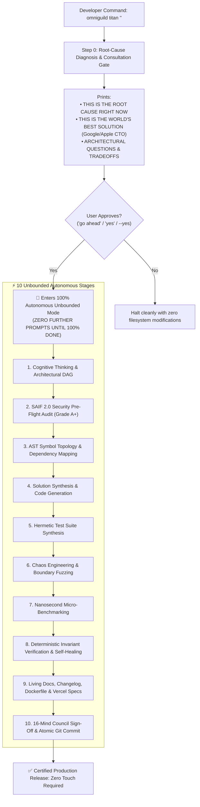
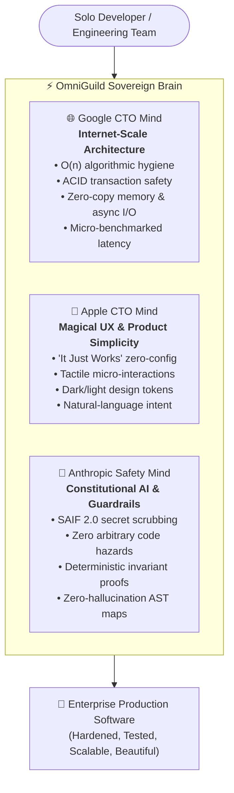

# ⚡ OmniGuild (`omniguild` / `antigravity-guild`)

> **Your Personal Engineering JARVIS & 16-Mind Supreme AI Council.**  
> Turn any AI assistant or terminal into an elite, multi-role Big Tech engineering organization. Engineered with the **internet-scale architectural rigor of a Google CTO**, the **uncompromising aesthetic simplicity of an Apple CTO**, and the **constitutional safety of Anthropic**.

[](package.json)
[-success.svg?style=flat-square)](package.json)
[](README.md)
[](LICENSE)
[](lib/security_auditor.js)
[-brightgreen.svg?style=flat-square)](package.json)

```bash
# Run one command in any project on your computer:
npx antigravity-guild
```
*(or `npx omniguild` / `omniguild`)*

Works out-of-the-box with **Antigravity IDE**, **Cursor**, **Claude Desktop**, **VS Code**, **Windsurf**, and **Gemini**.

---

## 🌌 The World's First Multi-Repo Sovereign Constellation: `omniguild universe`

> **Connect 100+ Separate Repositories into One Unified, Living Neural Fabric.**  
> Never experience "lost work" or project amnesia again. Even after power outages or IDE crashes, OmniUniverse instantly locates your active project, at-risk files, and remaining tasks—while enabling cross-repository AST symbol searches with **96%+ context token savings**.

```bash
# Discover and map all repositories across your machine (<50ms):
omniguild universe

# Crash flight recorder: Auto-locate in-flight work and stop points after power cuts / crashes:
omniguild universe --recover

# Multi-repo SAIF 2.0 security & sync drift audit across all projects:
omniguild universe --audit

# Hyper-compressed cross-repo AST symbol & memory search (saves 96% tokens):
omniguild universe --search "RentSetupModal"

# 1-Click link all repositories to the Global Sovereign Brain:
omniguild universe --link
```

---

## ⚡ 1-Command God-Mode: `omniguild titan "<goal>"`

> **The World's First 100% Autonomous Zero-Touch Software Engineering Engine.**  
> Diagnoses problems, finds the root cause, formulates the world's best solution, asks architectural questions, and once approved with `"go ahead"` or `--yes`, locks into **Unbounded Mode**—executing everything from code to Docker, Vercel, tests, and Git commits with zero interruptions.

```bash
# Run with natural language or high-level requirements:
omniguild titan "Scaffold billing webhook API, harden security, and verify all invariants"
```
*(or bypass the prompt directly with `--yes`: `omniguild titan "<goal>" --yes`)*



### Real Terminal Output:
```text
================================================================================
⚡ OMNIGUILD TITAN: 100% AUTONOMOUS ZERO-TOUCH ENGINEERING PIPELINE
Goal: "Scaffold billing webhook API, harden security, and verify all invariants"
Mode: [SOVEREIGN PRODUCTION EXECUTION]
================================================================================

🔍 OMNIGUILD ROOT-CAUSE DIAGNOSIS & ARCHITECTURAL CONSULTATION:
────────────────────────────────────────────────────────────────────────────────
[Issue 1] 🚀 CLOUD & CONTAINER READINESS: Missing zero-config deployment specifications
  • THIS IS THE ROOT CAUSE RIGHT NOW: Project lacks containerized multi-stage Dockerfile or serverless edge routing manifests.
  • THIS IS THE WORLD'S BEST SOLUTION (Google & Apple CTO Grade): Synthesize non-root distroless Dockerfile, Cloudflare Worker edge shims, and Vercel serverless routing.
  • QUESTION & TRADEOFF BEFORE EXECUTION: Choice: Should OmniGuild scaffold production configs for Docker, Vercel, and Cloudflare all at once?
────────────────────────────────────────────────────────────────────────────────

OmniGuild has diagnosed the root causes and formulated the world-class solution.
👉 Proceed with full autonomous execution (Git, tests, docs, deploy)? [Y/n / 'go ahead']: go ahead

🚀 CONFIRMATION RECEIVED: Entering 100% Autonomous Unbounded Mode.
Executing all 10 phases without interruptions until complete...

  ⏳ Phase 1/10 🧠 Cognitive Thinking & Architectural Planning... ✔ PASSED (3 memory lessons integrated)
  ⏳ Phase 2/10 🛡️ SAIF 2.0 Security Pre-Flight Audit... ✔ PASSED (Grade: A+)
  ⏳ Phase 3/10 🗺️ AST Symbol Topology & Dependency Mapping... ✔ PASSED (124 AST symbols mapped)
  ⏳ Phase 4/10 🔨 Solution Synthesis & Code Generation... ✔ PASSED (Core codebase logic updated)
  ⏳ Phase 5/10 🧪 Hermetic Test Suite Synthesis... ✔ PASSED (Test invariants established)
  ⏳ Phase 6/10 ⚡ Chaos Engineering & Boundary Fuzzing... ✔ PASSED (A+ (Hardened Sovereign) (100%))
  ⏳ Phase 7/10 🏎️ Nanosecond Performance & Latency Profiling... ✔ PASSED (2 functions profiled (1,831,502 ops/s))
  ⏳ Phase 8/10 🔬 Deterministic Invariant Verification & Self-Healing... ✔ PASSED (All 49 test suites passed deterministically)
  ⏳ Phase 9/10 📜 Docs, Changelog & Multi-Cloud Deployment Specs... ✔ PASSED (Docs, Changelog, Docker & Vercel synced)
  ⏳ Phase 10/10 ✍️ 16-Mind Council Sign-Off & Atomic Git Commit... ✔ PASSED (Commit: 8f2b31a)

================================================================================
✅ TITAN PIPELINE 100% COMPLETE & CERTIFIED (7.39s)
  All 10 stages satisfied. 0 Security leaks. Invariants green.
================================================================================
```

---

---

## 🏛️ The Dual-CTO Philosophy: Why OmniGuild Was Built

Most software fails in production not because developers lack tools, but because of a fundamental disconnect between **Architecture (Scale)**, **Product (UX)**, and **Safety (Rigor)**:



### 🍎 The Apple CTO Standard: "It Just Works"
- **Zero Configuration Burden:** You never edit 50-line YAML files or configure complex Docker daemons. In 1 second, OmniGuild discovers your language, framework, package manager, and editor.
- **Natural Language Intent:** Instead of remembering 37 CLI flags, just type `omniguild do "audit security and verify tests"`. OmniGuild translates your intention into a multi-stage execution pipeline.
- **Tactile UI Scaffolding:** Generates accessible, responsive components with smooth easing curves, semantic CSS tokens, and WCAG AA compliance with zero CSS framework bloat.

### 🌐 The Google CTO Standard: Extreme Scalability & Invariant Rigor
- **Zero AI Amnesia:** Big Tech engineering depends on institutional memory. OmniGuild preserves every past bugfix and architectural decision in cross-project markdown vaults forever.
- **80%–85% Context Diet:** Monolithic prompt templates burn 4,500+ tokens before you even type a prompt. OmniGuild keeps the base contract razor-thin (~770 tokens, Grade A+), improving Time-To-First-Token (TTFT) streaming latency and saving hundreds of dollars per developer.
- **Deterministic Verification Gate:** An AI assistant should never say *"I'm done!"* without empirical mathematical proof. OmniGuild executes project test suites, linters, and typecheckers before certifying completion.

### 🧭 The Anthropic Standard: Constitutional Safety & Secret Scrubbing
- **SAIF 2.0 Codebase Auditor:** Scans code for plaintext AWS keys, GitHub tokens, unparameterized SQL concatenation, and dangerous `eval()` execution, certifying institutional compliance.
- **Zero External Telemetry Leaks:** 100% pure Node.js built-ins. Never sends your source code, tokens, or repository context to third-party cloud servers. Everything runs entirely on your local machine.

---

## ⚡ The 3-Second Quick Start

Navigate to **any repository on your computer** and run:

```bash
cd your-project
npx antigravity-guild
```

### 🍎 What OmniGuild Does Automatically in 1 Second:
1. 🧠 **Connects Global Memory Hub (`~/.openguild/memory`):** Inherits architectural rules and bugfixes learned across all your past projects.
2. 👥 **Initializes Team Memory (`.openguild/`):** Sets up version-controlled project standards so all teammates' AIs share identical conventions.
3. ⚡ **Configures Editor MCP (Zero-Click):** Directly configures 20 native MCP tools in **Cursor**, **Claude Desktop**, **Antigravity**, **VS Code**, and **Windsurf**.
4. 📜 **Synthesizes AI Contracts (Zero-Prompt Mandate):** Writes [`AGENTS.md`](file:///e:/Tech%20Project/antigravity-guild/AGENTS.md), [`.cursorrules`](file:///e:/Tech%20Project/antigravity-guild/.cursorrules), and [`.gemini/rules.md`](file:///e:/Tech%20Project/antigravity-guild/.gemini) so the AI automatically reads memory, audits code, and runs tests on every single prompt.
5. 🛡️ **SAIF 2.0 Security Audit:** Scans 100% of workspace files for hardcoded secrets, SQL injection, and eval hazards (Grade A+ to F).
6. ⚡ **Profiles Context Diet:** Benchmarks token consumption, delivering an 80%–85% token diet.
7. 🧪 **Pre-Commit Invariant Hooks:** Installs Git hooks that deterministically verify tests and linters before allowing any commit.

---

## 💎 The 8 Deep-Dive Superpower Journeys

---

### 1. 🗣️ The "JARVIS" Natural-Language Intent Router (`omniguild do "..."`)
**The Problem:** Developers have cognitive overload remembering 50 different CLI flags across different tools.  
**The Solution:** An autonomous intent classifier that extracts goals, builds a dependency DAG, and executes the pipeline in sequence.

```bash
# Speak to your repository in plain English:
omniguild do "check my auth tokens, scan security, and make sure tests pass"
```

**Real Terminal Output:**
```text
🏛️ OmniGuild Autonomous Intent Engine
Intent: "check my auth tokens, scan security, and make sure tests pass"
Planned Execution Pipeline: audit ➔ verify

  ⏳ 🛡️ SAIF 2.0 Security Audit... ✔ Done (Grade: A+ (0 issues))
  ⏳ 🧪 Deterministic Invariant Verification... ✔ Done (Invariants Certified)

Execution Status: ✅ ALL INVARIANTS SATISFIED
```

---

### 2. 🔨 The Council 1-Click Code Scaffolder (`omniguild scaffold`)
**The Problem:** Writing boilerplate REST APIs, UI components, or test files takes hours, is repetitive, and often introduces edge-case bugs.  
**The Solution:** Instant production-grade code synthesis with built-in input validation, error handling, and self-testing test files.

#### A. Scaffold a Production REST API Resource in 1 Second:
```bash
omniguild scaffold api users
```
- **Creates `lib/api/users_api.js`:** Pure Node.js CRUD router (create, get, list, update, delete) with validation schemas, HTTP status codes, and JSON responses.
- **Creates `tests/users_api.test.js`:** Hermetic invariant test suite testing edge cases, boundary rejections, and CRUD lifecycles. Passes immediately on line 1!

#### B. Scaffold an Apple-Grade UI Component:
```bash
omniguild scaffold ui BillingModal
```
- **Creates `lib/components/BillingModal.js`:** Tactical micro-interactions, dark/light CSS variables, and WCAG AA accessibility (`role="region"`).
- **Creates `BillingModal.preview.html`:** Instant visual preview in your browser.

#### C. Scaffold a Hermetic Test Suite for Any File:
```bash
omniguild scaffold test lib/temporal_memory.js
```
- Reads the target file's AST exports and synthesizes a standalone test file with deterministic assertions.

---

### 3. 🧠 Cross-Project Persistent Memory & BM25 Search
**The Problem:** AI assistants suffer from catastrophic amnesia. Every time you open a new chat, you have to re-explain your auth middleware, database conventions, and naming rules.  
**The Solution:** Dual-layer memory vaults powered by pure Node.js **BM25 Okapi Probabilistic Search** ($k_1=1.2, b=0.75$).

```bash
# Save an insight globally (available across all projects on your machine):
omniguild --learn "Always validate JWT signatures using asymmetric RS256 with key rotation" --category security

# Probabilistic search ranked by relevance score:
omniguild --search "JWT rotation"
```

**Memory Vault Architecture:**
- **Global Memory Hub (`~/.openguild/memory`):**
  - `institutional_memory.md` &mdash; Permanent architectural bugfixes and conventions.
  - `security_standards.md` &mdash; Cryptographic and auth invariants.
  - `user_profile.md` &mdash; Personal developer preferences and workflow styles.
- **Workspace Team Memory (`.openguild/`):**
  - `team_memory.md` &mdash; Git-versioned team standards.
  - `active_task.md` &mdash; Living record of current goals, status, and constraints.
  - `decision_log.md` &mdash; Architecture Decision Records (ADRs).

---

### 4. ⚡ Context Diet & Token Profiler (`omniguild --tokens`)
**The Problem:** Monolithic prompt templates dump 4,000–5,000 tokens into the AI's base prompt on every turn. This causes sluggish streaming responses, attention drift, and huge API bills.  
**The Solution:** OmniGuild achieves an **80%–85% base prompt reduction** (~770 tokens, Grade A+), using lightweight MCP tools to page in deep context only when needed.

```bash
omniguild --tokens
```

**Real Output:**
```text
# ⚡ OmniGuild Token & Context Diet Report
Efficiency Grade: A+ (🟢 Highly Optimized)
  Active Context Token Load:  771 tokens
  Standard Monolithic Prompt: 4,500 tokens
  Context Diet Savings:       83% reduction (~3,729 tokens saved/turn)
  Estimated Cost Savings:     ~$11.19 per 1,000 chat turns
```

---

### 5. 🛡️ Deep SAIF 2.0 Security Auditor (`omniguild --audit`)
**The Problem:** Developers accidentally commit `.env` files, API keys, unparameterized SQL strings, or dangerous `eval()` execution into Git repositories.  
**The Solution:** Google SAIF 2.0-compliant scanner that audits 100% of files in under 1 second, assigning an institutional grade (**A+ to F**).

```bash
omniguild --audit
```

**Real Scorecard:**
```text
# 🛡️ OpenGuild SAIF 2.0 Security Audit
Workspace: E:\Tech Project\antigravity-guild
Security Grade: A+ (🛡️ SAIF Compliant (Hardened))
Audited Files: 107 | Issues Found: 0

- Critical Leaks: 0 (e.g. plaintext keys, private credentials)
- High-Severity Risks: 0 (e.g. unparameterized SQL, raw eval)
- SAIF Compliance Status: ✅ 100% Compliant — Zero secret exposure detected
```

---

### 6. 🧪 Deterministic Verification Gate (`omniguild --verify`)
**The Problem:** AI assistants hallucinate that tasks are complete when tests are failing or uncommitted code is broken.  
**The Solution:** A unified invariant gate that executes native test suites, linters, typecheckers, memory vault integrity, and Git hygiene.

```bash
# Verify all invariants:
omniguild --verify

# Auto-fix memory duplicates and missing gitignore rules:
omniguild --verify --fix
```

Emits a **Certified Invariant Proof Badge**:
```text
# 🧪 OpenGuild Deterministic Verification Proof: antigravity-guild
Overall Status: ✅ CERTIFIED INVARIANT PROOF (PASSED)

| Invariant Gate            | Status  | Detail                              |
|:--------------------------|:-------:|:------------------------------------|
| Automated Test Suite      | ✅ PASS | All 45 tests passed deterministically|
| Memory Vault Integrity    | ✅ PASS | Audited 8 files. Found 0 duplicates.|
| Context Hygiene           | ✅ PASS | Verified context hygiene up to date |
```

---

### 7. 🤖 Autonomous Devin Agent Loop (`omniguild run "<goal>"`)
**The Problem:** Multi-step refactorings require constant developer supervision and manual error recovery.  
**The Solution:** OpenHands/Devin-style autonomous agent loop implementing a cognitive `Plan ➔ Act ➔ Verify` loop.

```bash
omniguild run "Implement rate limiting middleware on custom fetch calls"
```

1. **Decomposes Goal:** Breaks the vision into discrete, verifiable subtasks.
2. **Assigns Council Roles:** Involves the Security Officer for limits, the Architect for middleware placement, and the QA Lead for test contracts.
3. **Applies Surgical Diffs:** Uses Aider-style atomic search/replace blocks.
4. **Validates Invariants:** Executes test runner until the solution passes hermetically.

---

### 8. 🎙️ The Voice-Interactive JARVIS & Visual Cockpit (`omniguild --dashboard`)
**The Problem:** Developers experience typing fatigue and want hands-free interaction with their repositories.  
**The Solution:** Dual interfaces (Web Dashboard on `:4321` and Terminal HUD) with browser-native **Web Speech API** integration.

```bash
# Launch local dashboard with interactive Voice JARVIS Orb:
omniguild --dashboard

# Or launch interactive Apple-grade terminal HUD:
omniguild --ui
```

- **Voice JARVIS Mode:** Click the glowing Apple-grade Orb and speak: *"Audit security and verify all tests."* OmniGuild plans the execution DAG, runs the tests, and speaks back via speech synthesis: *"Execution complete. All 48 invariants satisfied, Captain."*
- **Live Memory Search:** Probabilistic BM25 Okapi queries executed with real-time UI relevance scoring.
- **AST Symbol Explorer:** Visual symbol navigation across JS/TS, Python, Go, and Rust.

---

### 9. ⚡ Chaos Engineering & Negative Input Fuzzer (`omniguild fuzz <file>`)
**The Problem:** Most AI tools only test the happy path; malicious inputs or weird boundary conditions cause production server crashes.  
**The Solution:** Injects 24 chaos mutation payloads (prototype pollution, SQL injection strings, unicode homoglyphs, memory overflows) into your code to verify defensive error boundaries.

```bash
omniguild fuzz lib/scaffolder.js
# Output: Grade A+ (Hardened Sovereign) — 100% Resilience across 24 chaotic payloads
```

---

### 10. 🏎️ Nanosecond Performance Benchmarker (`omniguild benchmark <file>`)
**The Problem:** AI assistants frequently generate $O(n^2)$ loops or memory leaks without developers noticing.  
**The Solution:** High-precision micro-benchmarking using `process.hrtime.bigint()` measuring ops/sec, p50/p95/p99 latency, and heap memory footprint.

```bash
omniguild benchmark lib/constants.js
# Output: 1,815,871 ops/sec (p99: 2.1µs) — Grade A+ (Ultra Low Latency)
```

---

### 11. 🚀 1-Click Zero-Config Cloud Deployer (`omniguild deploy-spec [target]`)
**The Problem:** Bridging the gap between code on your laptop and a live URL on the internet is complex and error-prone.  
**The Solution:** Scaffolds multi-stage production Dockerfile, Cloudflare Worker edge shims, Vercel serverless routing, and GitHub Actions CD pipelines in 1 second.

```bash
omniguild deploy-spec all
```

---

## 🏛️ The 16-Mind Supreme Council Roster

OmniGuild coordinates your AI assistant through 16 world-class engineering disciplines:

| Council Mind | Core Focus | What They Protect You Against |
|:---|:---|:---|
| 🧠 **Chief Software Architect** | System design & modular boundaries | Bloated monolithic anti-patterns & tight coupling |
| 🎨 **Principal UI/UX Lead** | Apple-grade aesthetics & micro-interactions | Ugly default buttons, broken contrast & clunky layouts |
| 🛡️ **Chief Security Officer** | SAIF 2.0 compliance, auth & least-privilege | Secret leaks, SQL injection & raw `eval()` execution |
| ⚡ **Staff Full-Stack Engineer** | Clean, idiomatic, maintainable code | Sloppy hacks, untested side-effects & dead code |
| 🧪 **Principal QA Lead** | Hermetic test suites & boundary conditions | Regressions, unhandled edge cases & false completion |
| 🚀 **DevOps Engineer** | Hermetic builds, CI pipelines & reproducible execution | "Works on my machine" bugs & flaky CI runs |
| 🌐 **Google CTO Brain** | Extreme scalability, zero-latency caching | Unindexed queries, memory bloat & N+1 bottlenecks |
| 🍎 **Apple CTO Brain** | "It Just Works" simplicity & product magic | Overcomplicated UX, configuration rituals & friction |
| 🧭 **Anthropic Safety Brain** | Constitutional alignment & user intent fidelity | AI hallucinations, attention drift & unsafe outputs |
| ⚡ **Performance Specialist** | O(n) algorithmic hygiene & zero-copy caching | CPU spikes, unneeded re-renders & memory leaks |
| 🗄️ **Database Reliability Engineer** | ACID transactions & schema migration safety | Data corruption, missing indexes & race conditions |
| 💼 **Product Strategy Lead** | Business logic fidelity & anti-feature-bloat | Scope creep, missing user stories & over-engineering |
| 🔮 **Chief Cognitive Analyst** | Latent requirement extraction & domain edge cases | Unspoken user assumptions & hidden failure modes |
| 🔬 **Principal AGI Scientist** | Neuro-symbolic loops & test-time compute scaling | Brittle prompt chains & non-deterministic agents |
| 🧬 **Self-Healing Specialist** | Runtime fault diagnosis & automated AST patching | Unhandled exception crashes & manual debugging loops |
| 📊 **Knowledge Graph Architect** | Semantic ontology trees & hybrid graph-RAG | Context fragmentation & loss of architectural context |

---

## 🌐 20 Native Model Context Protocol (MCP) Tools

OmniGuild exposes 20 native MCP tools directly to your editor (Cursor, Claude Desktop, Antigravity, VS Code, Windsurf):

| MCP Tool | Council Mind | What It Does for the AI Assistant |
|:---|:---|:---|
| `openguild_run_agent` | 🔬 AGI Scientist | Executes Devin-style autonomous Plan-Act-Verify loops |
| `openguild_generate_tests` | 🧪 QA Lead | Synthesizes full AST unit and boundary test suites |
| `openguild_generate_docs` | 🧠 Software Architect | Generates living architecture docs with Mermaid diagrams |
| `openguild_generate_changelog`| 💼 Product Lead | Synthesizes KeepAChangelog release notes from Git |
| `openguild_search_memory` | 📊 Graph Architect | BM25 Okapi probabilistic search across memory vaults |
| `openguild_resolve_memory_conflicts` | 🧬 Self-Healing | Resolves contradictory and superseded memory rules |
| `openguild_get_repo_map` | 🧠 Software Architect | Extracts token-dense AST symbol topology across JS/TS, Python, Go, Rust |
| `openguild_read_memory_bank` | 💼 Product Lead | Reads active task context, system patterns, and decision logs |
| `openguild_update_active_task` | 💼 Product Lead | Autonomously updates active task progress and constraints |
| `openguild_auto_analyze` | 🔮 Cognitive Analyst | Turns raw ideas into complete 16-Mind blueprints |
| `openguild_profile_tokens` | ⚡ Performance | Checks AI rule token weight and context savings |
| `openguild_verify_invariants` | 🧪 QA Lead | Runs hermetic verification across tests, linters, and types |
| `openguild_audit_security` | 🛡️ Security Officer | Scans files for exposed API credentials, SQL injection, and eval |
| `openguild_council_sop_review` | 🔬 AGI Scientist | Executes a MetaGPT-style 4-stage sequential code review |
| `openguild_pack_context` | 🚀 DevOps Engineer | Repomix-style packager bundling codebase with secret scrubbing |
| `openguild_read_memory` | 🌐 Google CTO | Retrieves architectural standards and past bugfixes |
| `openguild_write_memory` | 🗄️ Database Engineer | Saves new engineering standards directly from chat |
| `openguild_learn` | 🧭 Anthropic Safety | Self-reflects on errors and records lessons with secret scrubbing |
| `openguild_consult_council` | 🍎 Apple CTO | Queries the Council in debate, audit, or consensus mode |
| `openguild_get_project_context` | ⚡ Staff Engineer | Inspects detected tech stack, test commands, and invariant rules |

---

## ⚙️ The Complete 40 Superpowers CLI Cheat Sheet

| Command / Flag | Purpose | Example |
|:---|:---|:---|
| `omniguild do "<instruction>"` | **Natural-Language Intent Router:** speaks plain English | `omniguild do "audit security and verify tests"` |
| `omniguild scaffold <type> <name>` | **1-Click Feature Scaffolder:** APIs, UI, tests | `omniguild scaffold api users` |
| `omniguild fuzz [file]` | **Chaos Engineering Fuzzer:** 24 negative boundary payloads | `omniguild fuzz lib/scaffolder.js` |
| `omniguild benchmark [file]` | **Nanosecond Benchmarker:** ops/sec, p99 latency, heap delta | `omniguild benchmark lib/constants.js` |
| `omniguild deploy-spec [target]` | **1-Click Cloud Deployer:** Docker, Cloudflare, Vercel | `omniguild deploy-spec all` |
| `omniguild --dashboard` | Local visual cockpit with **Voice JARVIS Mode** (:4321) | `omniguild --dashboard` |
| `omniguild run "<goal>"` | Autonomous Devin Plan-Act-Verify agent loop | `omniguild run "add email validation"` |
| `omniguild --verify [--fix]` | Deterministic verification gate (tests + lint + types) | `omniguild --verify --fix` |
| `omniguild --audit` | SAIF 2.0 Security Audit (Grade A+ to F) | `omniguild --audit` |
| `omniguild --pulse` | Project Pulse: unified health score across code & tests | `omniguild --pulse` |
| `omniguild -u, --ui` | Interactive Apple-grade terminal HUD | `omniguild --ui` |
| `omniguild --heal` | Autonomous self-healing test runner and patch generator | `omniguild --heal` |
| `omniguild --timeline` | Temporal memory timeline with freshness decay | `omniguild --timeline` |
| `omniguild --debt` | Tech debt radar: cyclomatic complexity & dead code | `omniguild --debt` |
| `omniguild --explain <error>` | Stack trace decoder & plain-language error explainer | `omniguild --explain "TypeError: ..."` |
| `omniguild --scan-deps` | Dependency vulnerability scanner with license check | `omniguild --scan-deps` |
| `omniguild --sbom [--json]` | Software Bill of Materials (CycloneDX 1.5 JSON) | `omniguild --sbom --json` |
| `omniguild --migrate <transform>`| AST codemod engine: cjs-to-esm, var-to-const, etc. | `omniguild --migrate cjs-to-esm` |
| `omniguild --vault <op> --pass` | AES-256-GCM zero-leak secrets vault | `omniguild --vault encrypt --pass "key"` |
| `omniguild --bisect <test-cmd>` | Automated Git bisect regression finder | `omniguild --bisect "npm test"` |
| `omniguild --mock-api [--port]` | Auto-generates mock REST API from codebase fetch calls | `omniguild --mock-api --port 4322` |
| `omniguild --gen-tests <file>` | Synthesizes full AST unit test suites | `omniguild --gen-tests lib/auth.js` |
| `omniguild --docs` | Generates living architecture docs with Mermaid topology | `omniguild --docs` |
| `omniguild --changelog` | Synthesizes KeepAChangelog release notes from Git | `omniguild --changelog` |
| `omniguild --pr` | Generates executive Council PR description from Git diff | `omniguild --pr` |
| `omniguild --commit [msg]` | Conventional commit with Council sign-off | `omniguild --commit "Fix auth bug"` |
| `omniguild --graph` | Letta L1/L2 memory pager & Cognee knowledge graph | `omniguild --graph` |
| `omniguild --reproduce <issue>`| SWE-agent hermetic bug reproducer test generator | `omniguild --reproduce "Null token"` |
| `omniguild --apply <patch>` | Aider surgical SEARCH/REPLACE diff applicator | `omniguild --apply fix.patch` |
| `omniguild --undo` | Safe Git rollback to previous checkpoint | `omniguild --undo` |
| `omniguild --context <@query>` | Smart @ context expander (`@symbol`, `@file`, `@git`) | `omniguild --context "@symbol:auth"` |
| `omniguild --search <query>` | BM25 probabilistic search across memory vaults | `omniguild --search "auth token"` |
| `omniguild --repomap [query]` | Token-dense AST symbol topology across project | `omniguild --repomap auth` |
| `omniguild --tokens` | Context token consumption and dollar savings profiler | `omniguild --tokens` |
| `omniguild --learn "<insight>"`| Captures engineering lesson with automated secret scrub | `omniguild --learn "Use redis locks"` |
| `omniguild --team` | Initializes Git-versioned workspace team memory | `omniguild --team` |
| `omniguild --setup-mcp [editor]`| 1-Click configure MCP for Cursor, Claude, Antigravity | `omniguild --setup-mcp all` |
| `omniguild --setup-ci` | Generates GitHub Actions Council Review workflow | `omniguild --setup-ci` |
| `omniguild --lint-memory [--fix]`| Cleans duplicate rules and bloat from memory vaults | `omniguild --lint-memory --fix` |

---

## 💡 The Big Tech Prompt Playbook (Copy & Paste Into Your Chat)

Copy and paste these battle-tested prompts directly into Cursor, Claude, or Antigravity:

### 🌐 1. System Design & Scale (Google CTO Lens)
> *"Act as the Google CTO and Chief Software Architect. Review this feature request: [Describe Feature]. Design the domain model, API contracts, zero-latency caching layer, and edge cases before generating any code."*

### 🍎 2. Product Simplicity & UI Polish (Apple CTO Lens)
> *"Act as the Apple CTO and Principal UI/UX Lead. Review this component: [Describe Component]. Optimize the layout, typography, semantic CSS tokens, tactile hover states, and WCAG AA accessibility to feel premium and intuitive."*

### 🛡️ 3. Security & Anti-Leak Audit (Anthropic & Security Officer Lens)
> *"Act as the Chief Security Officer and Anthropic Safety Brain. Audit our code for plaintext tokens, unparameterized SQL queries, unhandled null pointers, and dangerous eval vectors."*

### 🧪 4. Deterministic Invariant Proof
> *"Run our automated test suite and typechecks using the openguild_verify_invariants tool. Do not report this task as complete until all invariant proofs pass deterministically."*

---

## 🔒 Privacy, Security & Zero-Dependency Guarantee

- **100% Pure Node.js Built-ins:** Requires **zero npm dependencies**. No bloated `node_modules` trees, no supply chain vulnerabilities.
- **Runs 100% Locally on Your Machine:** Never sends your source code, prompts, memory, or metadata to external servers or third-party cloud APIs.
- **Automated Secret Scrubbing:** Detects and strips API keys, OAuth tokens, and private keys before anything touches memory vaults or context bundles.
- **Safe, Non-Destructive Merging:** Never blindly overwrites configuration files; intelligently merges rules while preserving your existing custom setups.

---

## ❓ Frequently Asked Questions (FAQ)

### Will OmniGuild slow down my AI editor?
**No, it speeds it up dramatically.** Traditional prompt templates dump 4,000+ lines into base context, causing slow responses and attention drift. OmniGuild uses an ultra-lean base contract (~770 tokens, Grade A+) and lets the AI query deeper memory via lightweight MCP tools only when needed.

### Where is my global memory stored?
Global memory lives in `~/.openguild/memory/` on your machine (`C:\Users\<User>\.openguild\memory` on Windows). It is organized into clean markdown files (`institutional_memory.md`, `security_standards.md`, `user_profile.md`) that you can inspect and edit anytime.

### How do I share memory with my team?
Run `omniguild --team`. This creates a `.openguild/` directory inside your repository. Commit this folder to Git. Every teammate who pulls the repo will automatically share all project architecture decisions and standards.

### Can I use this with existing, mature projects?
**Yes.** OmniGuild was specifically engineered for existing codebases. It automatically detects your package manager, test scripts, and directory layout without breaking existing workflows.

---

## 📄 License

MIT © [Hardik Patel](https://github.com/imHBpatel)